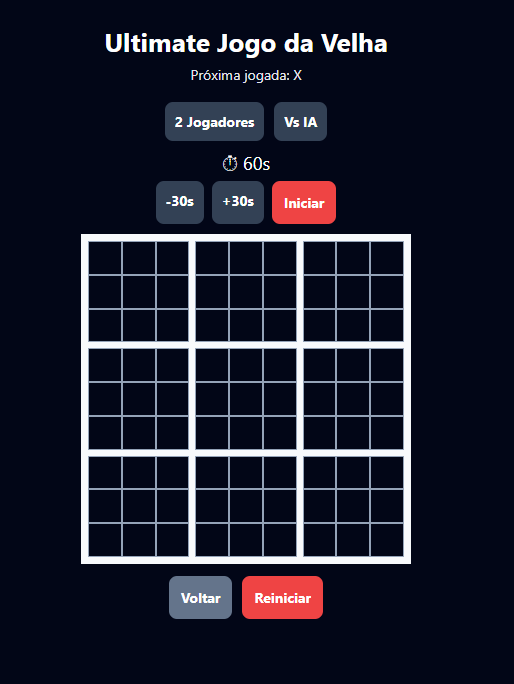
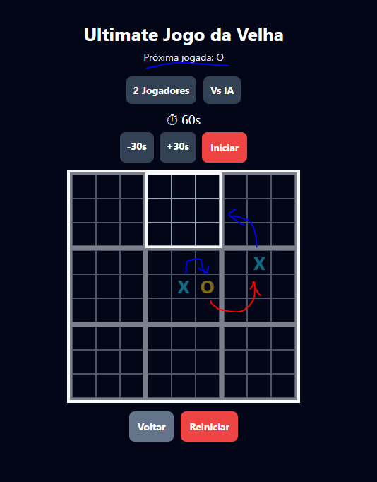

# ♟ Ultimate Jogo da Velha

Versão avançada do Jogo da Velha (Ultimate Tic Tac Toe) feita com **React Native + Expo**.

## ▶️ Como jogar

Dois jogadores se alternam: X e O
No início, o primeiro jogador pode jogar em qualquer tabuleiro pequeno



A posição da jogada define em qual tabuleiro o próximo jogador deve jogar
Exemplo:
- Se você jogar no canto superior direito de um tabuleiro pequeno
- O próximo jogador será enviado para o tabuleiro superior direito do tabuleiro principal




Se o tabuleiro de destino já tiver um vencedor, mas ainda possuir casas vazias,
o jogador deve jogar nele. Se estiver totalmente preenchido, pode escolher
qualquer outro tabuleiro que ainda tenha casas vazias.

## 🏆 Como vencer

Vence quem conquistar 3 tabuleiros pequenos em linha no tabuleiro principal


Empates em tabuleiros pequenos continuam valendo como bloqueados
Se todos os tabuleiros forem concluídos sem um vencedor no tabuleiro principal, o jogo termina em empate

## 💡 Dica

Planeje não só sua jogada atual, mas onde você vai obrigar o adversário a jogar depois 😉

## ✨ Funcionalidades
- 2 jogadores local
- Modo contra IA
- Timer por jogada
- Undo / Reset
- Destaque de vitórias (tabuleiro pequeno e grande)

## 🚀 Tecnologias
- React Native
- Expo
- TypeScript

## ▶️ Rodando localmente
```bash
npm install
npx expo start
```
## 🌐 Versão Web

O workflow do GitHub Pages publica o jogo Expo Web em `/jogo/`. O build configura
esse caminho base para que os arquivos estáticos funcionem no subdiretório.
Após o deploy, acesse:

```text
https://gutembergbs.github.io/ultimate-velha/jogo/
```

Para testar localmente:

```bash
npx expo start --web
``` 

## 🔒 Política de Privacidade

A política pública do aplicativo está em
[gutembergbs.github.io/ultimate-velha/politica-de-privacidade/](https://gutembergbs.github.io/ultimate-velha/politica-de-privacidade/).
Atualize a página caso as práticas de dados do aplicativo ou a configuração do
Supabase mudem.

## 📁 Portfólio

O portfólio pessoal foi separado deste projeto e está em
[Gutembergbs/portfolio](https://github.com/Gutembergbs/portfolio), publicado em
<https://gutembergbs.github.io/portfolio/>. A página inicial e a política de
privacidade deste jogo permanecem neste repositório: a página inicial em
`pages/` e a política em `public/`.

O workflow `.github/workflows/deploy-game.yml` publica o jogo e as páginas
do aplicativo no GitHub Pages após push para `main`. No GitHub, habilite
**Settings → Pages → Source: GitHub Actions**.

Desenvolvido com 💙 por Gutemberg
