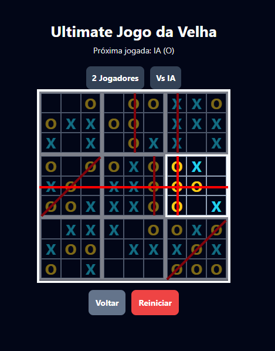

# ♟ Ultimate Jogo da Velha

Versão avançada do Jogo da Velha (Ultimate Tic Tac Toe) feita com **React Native + Expo**.

## ▶️ Como jogar

Dois jogadores se alternam: X e O
No início, o primeiro jogador pode jogar em qualquer tabuleiro pequeno


A posição da jogada define em qual tabuleiro o próximo jogador deve jogar
Exemplo:
- Se você jogar no canto superior direito de um tabuleiro pequeno
- O próximo jogador será enviado para o tabuleiro superior direito do tabuleiro principal


Se o tabuleiro de destino já tiver um vencedor, mas ainda possuir casas vazias,
o jogador deve jogar nele. Se estiver totalmente preenchido, pode escolher
qualquer outro tabuleiro que ainda tenha casas vazias.

## 🏆 Como vencer

Vence quem conquistar 3 tabuleiros pequenos em linha no tabuleiro principal



Empates em tabuleiros pequenos continuam valendo como bloqueados
Se todos os tabuleiros forem concluídos sem um vencedor no tabuleiro principal, o jogo termina em empate

## 💡 Dica

Planeje não só sua jogada atual, mas onde você vai obrigar o adversário a jogar depois 😉

## ✨ Funcionalidades
- 2 jogadores local
- Modo contra IA
- Timer por jogada
- Undo / Reset
- Destaque de vitórias (tabuleiro pequeno e grande)

## 🚀 Tecnologias
- React Native
- Expo
- TypeScript

## ▶️ Rodando localmente
```bash
npm install
npx expo start
```
## 🌐 Versão Web

O workflow do GitHub Pages publica o jogo Expo Web em `/jogo/`. O build configura
esse caminho base para que os arquivos estáticos funcionem no subdiretório.
Após o deploy, acesse:

```text
https://gutembergbs.github.io/ultimate-velha/jogo/
```

Para testar localmente:

```bash
npx expo start --web
``` 

## 🔒 Política de Privacidade

A política pública do aplicativo está em
[gutembergbs.github.io/ultimate-velha/politica-de-privacidade/](https://gutembergbs.github.io/ultimate-velha/politica-de-privacidade/).
Atualize a página caso as práticas de dados do aplicativo ou a configuração do
Supabase mudem.

## 📁 Portfólio

O portfólio pessoal foi separado deste projeto e está em
[Gutembergbs/portfolio](https://github.com/Gutembergbs/portfolio), publicado em
<https://gutembergbs.github.io/portfolio/>. A página inicial e a política de
privacidade deste jogo permanecem neste repositório: a página inicial em
`pages/` e a política em `public/`.

O workflow `.github/workflows/deploy-game.yml` publica o jogo e as páginas
do aplicativo no GitHub Pages após push para `main`. No GitHub, habilite
**Settings → Pages → Source: GitHub Actions**.

## 📱 Preparar publicação na Google Play

O projeto já tem um perfil EAS `production` que gera um Android App Bundle (AAB)
e incrementa o código de versão. Siga este roteiro para publicar:

1. **Prepare as contas e o cadastro.** Crie uma conta de desenvolvedor no
   [Google Play Console](https://play.google.com/console/signup), conclua as
   verificações solicitadas e crie o app. Use o identificador já configurado
   `com.gutemberg_bs.ultimatevelha`; o nome de pacote não pode ser trocado após
   a publicação. O EAS também exige uma conta Expo.
2. **Complete a ficha e as declarações no Play Console.** Preencha descrição,
   ícone, capturas de tela, categoria, contato e classificação indicativa.
   Informe corretamente anúncios, acesso ao app e a seção Segurança dos dados
   com base no que o app e o Supabase coletam. Disponibilize uma política de
   privacidade pública e funcional e confira os requisitos de nível de API
   vigentes no Console antes de enviar.
3. **Gere o AAB de produção.** No terminal, na raiz do projeto:

   ```bash
   npx eas-cli@latest login
   npx eas-cli@latest whoami
   npx eas-cli@latest build --platform android --profile production
   ```

   Na primeira compilação, aceite configurar as credenciais Android no EAS ou
   deixe-o gerar a chave de assinatura. Guarde um backup seguro; nunca publique
   keystores ou chaves de serviço no Git.
4. **Configure o envio e faça um teste interno.** Para submissão automática pelo
   EAS, configure uma conta de serviço do Google Play no projeto Expo
   ([guia oficial](https://docs.expo.dev/submit/android/)). O perfil `production`
   de submissão deste repositório aponta para a faixa `internal`:

   ```bash
   npx eas-cli@latest submit --platform android --profile production --latest
   ```

   Também é possível baixar o AAB no link que o EAS mostra ao terminar o build e
   enviá-lo manualmente pela Play Console. Convide testadores e valide instalação,
   partidas locais, IA, modo online e diferentes tamanhos de tela.
5. **Faça o teste fechado, se exigido para sua conta.** Contas pessoais criadas
   depois de 13 de novembro de 2023 precisam de pelo menos 12 testadores inscritos
   continuamente em um teste fechado por 14 dias antes de solicitar acesso à
   produção. O teste interno, sozinho, não substitui esse requisito. Confira as
   regras atuais para sua conta no
   [suporte do Google Play](https://support.google.com/googleplay/android-developer/answer/14151465).
6. **Solicite acesso à produção e lance.** Após concluir os testes e as tarefas do
   painel, solicite acesso à produção se o Console exigir. Crie uma versão na
   faixa **Produção**, revise países, preço e notas da versão, envie para análise
   e inicie o lançamento quando aprovado.
7. **Publique atualizações.** Altere `expo.version` em `app.json` quando quiser
   atualizar a versão visível, gere um novo AAB com o perfil `production` e envie
   a atualização pelo Play Console ou por `eas submit`.

Referências: [criar e configurar um app](https://support.google.com/googleplay/android-developer/answer/9859152),
[gerar builds com Expo](https://docs.expo.dev/build/setup/) e
[enviar ao Google Play com EAS](https://docs.expo.dev/submit/android/).

Desenvolvido com 💙 por Gutemberg
